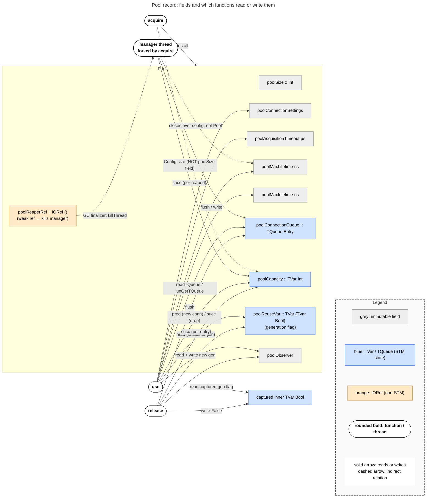
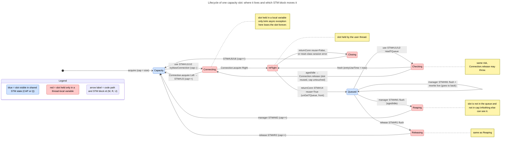
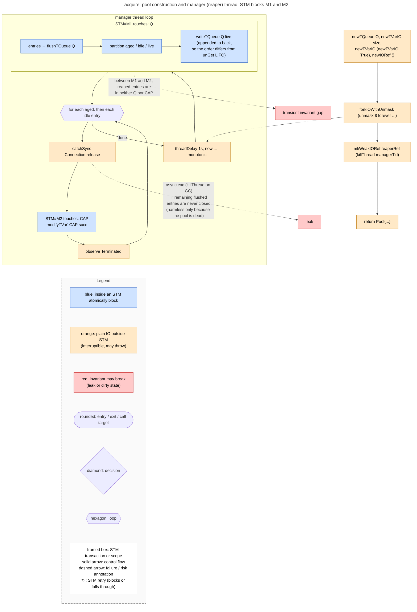
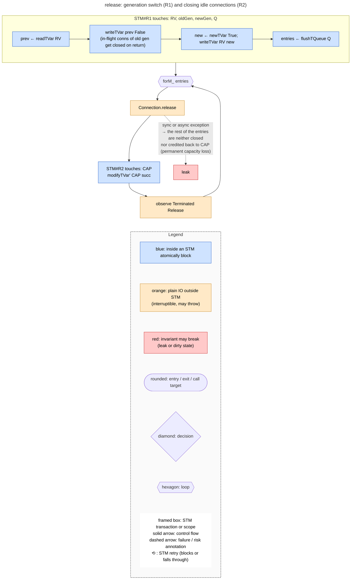
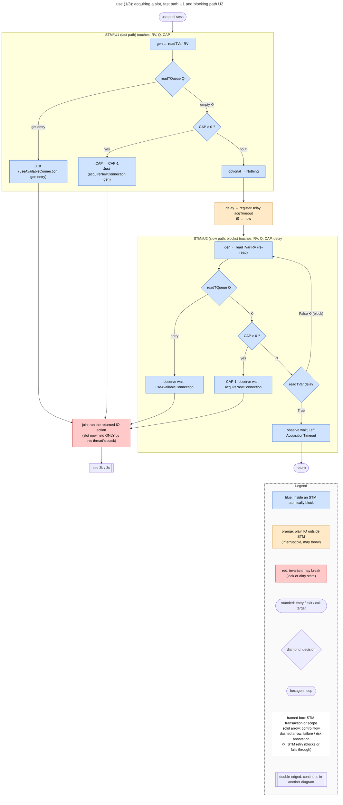
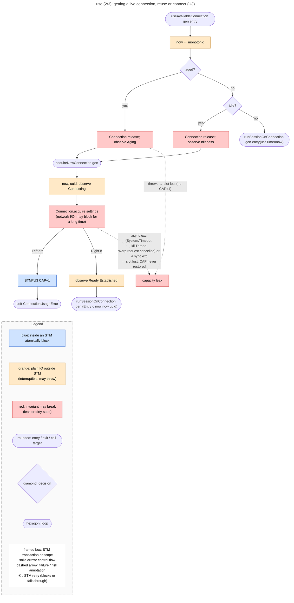
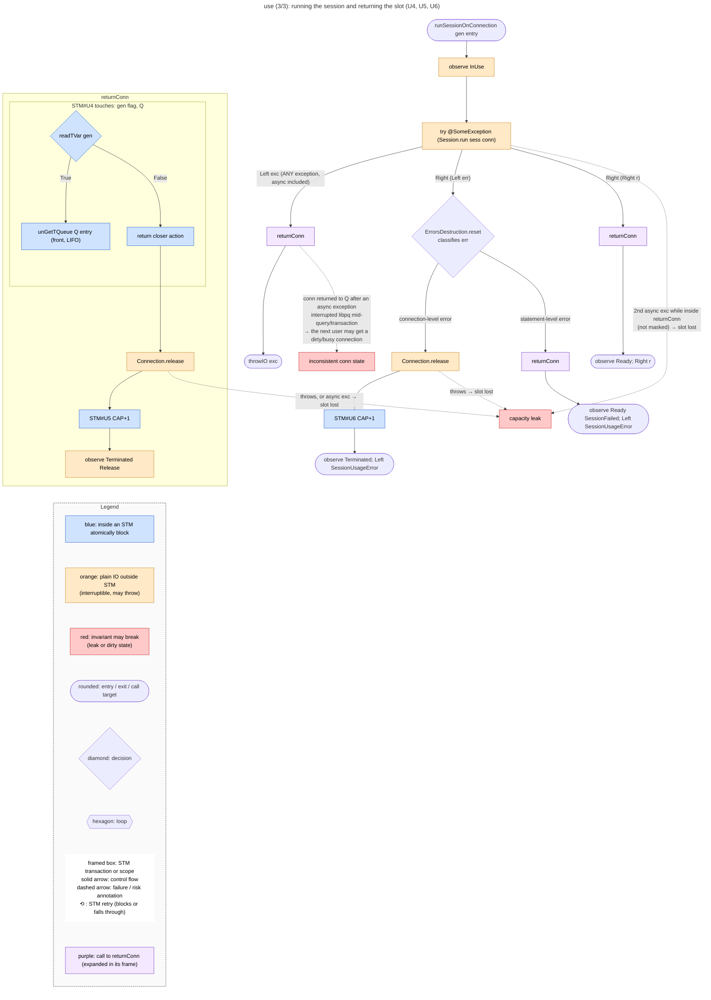
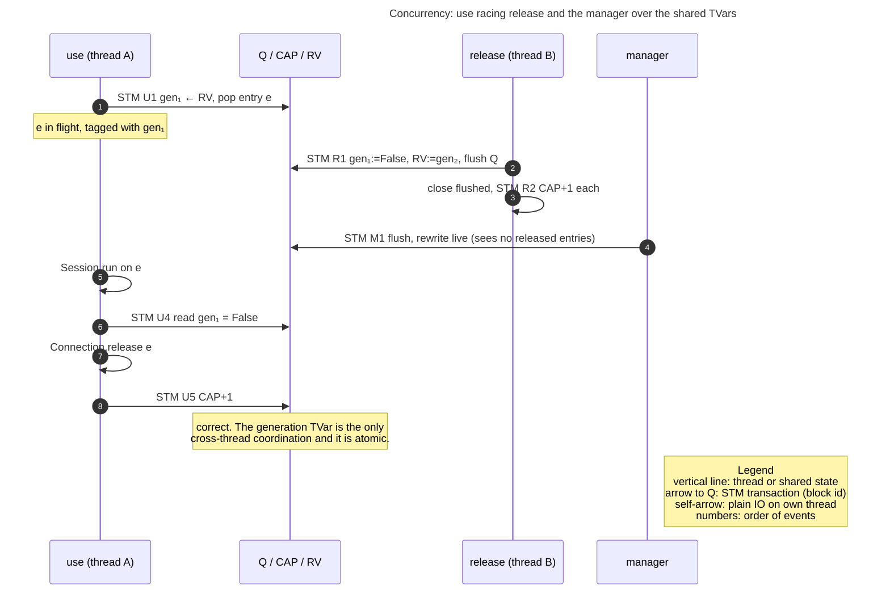

# `Hasql.Pool` — structure, STM transactions and slot accounting

Format: Mermaid, so it renders on GitHub, VS Code and `mmdc`.
- **Flowcharts** for control flow inside each function.
- **State diagram** for the lifecycle of a capacity slot. This is where the invariant lives.
- **Sequence diagram** for the `use`/`release` interaction.

Legend used in every flowchart:

| Shape / colour | Meaning |
|---|---|
| blue box (`stm`) | code running **inside** an `atomically` block (`STM#n`) |
| orange box (`io`) | plain `IO` that is **outside** STM (it can be interrupted, can throw, and is not atomic) |
| red box (`risk`) | point where the invariant can break (leak or inconsistent state) |
| `⟲ retry` | STM `retry` (blocks until a TVar that was read changes) |

---

## 0. The `Pool` record and who touches what

Notes:
- `poolSize` is **never read** after construction. The invariant
  `poolSize == capacity + length queue + inFlight + inLimbo` exists only in a comment and nothing checks it.
- The manager thread does **not** read the `Pool` record. It closes over `config` and the raw `TVar`s. This
  matters for the weak-ref trick: if the manager held the `Pool`, the pool would never be garbage collected.

### Where a connection slot can be (invariant view)

Every state except `Capacity` and `Queued` exists only in a Haskell local variable. Nothing sees those slots
again unless the code reaches the matching `cap++`. The code does not use `mask`, `bracket`,
`onException` or `finally`.

---

## 1. `acquire`, including the manager (reaper) thread

STM blocks: **M1** (once per second), **M2** (once per reaped entry).

---

## 2. `release`

STM blocks: **R1** (once), **R2** (once per idle entry).

R1 is a single correct atomic step. All the bookkeeping that follows it is unprotected.

---

## 3. `use` (main focus)

STM blocks:

| id | where | TVars read | TVars written | can `retry`? |
|---|---|---|---|---|
| **U1** | fast path, `optional (...)` | RV, Q, CAP | Q (pop) **or** CAP (`-1`) | no (turned into `Nothing`) |
| **U2** | slow path, `join . atomically` | RV, Q, CAP, delay TVar | Q (pop) **or** CAP (`-1`) | yes, wakes on any change to Q/CAP/delay |
| **U3** | `acquireNewConnection`, connect failed | CAP | CAP `+1` | no |
| **U4** | `returnConn` | captured gen flag, Q | Q (`unGetTQueue`, front) | no |
| **U5** | `returnConn`, generation is stale | CAP | CAP `+1` | no |
| **U6** | session error classified as `reset` | CAP | CAP `+1` | no |

### 3a. Acquisition phase

### 3b. Obtaining a live connection

### 3c. Running the session and giving the slot back

---

## 4. Concurrency: `use` racing `release` and the manager

The generation trick is sound because each of U1, U2 and U4 reads `RV` (or the captured flag) in the same
transaction as the queue operation. The races that remain are between the STM blocks, not inside them.

---

## 5. Findings

### Safety (in order of severity)

1. **No async-exception masking anywhere in `use`.** After U1 or U2 commits, the slot (a `CAP` decrement or a
   popped `Entry`) is held only on the thread's stack. If an async exception lands during
   `Connection.acquire`, `Connection.release`, the observers or `returnConn` (`timeout`, `killThread`,
   Warp cancellation), the slot is lost for good. Repeated losses shrink the pool towards 0, after which
   every `use` returns `AcquisitionTimeout`. Fix: `mask` around acquire → act → return, using
   `bracketOnError`/`onException` so every exit path does `CAP+1`.
2. **`try @SomeException` catches async exceptions, then returns the connection to the pool**
   (`Pool.hs:225-230`). A `Session.run` that is cancelled half-way leaves libpq busy or inside an open
   transaction, and the next borrower gets that connection. Safer behaviour: on an async exception, close the
   connection (U6-style) and do not `unGetTQueue` it.
3. **`release` loop is not exception-safe** (`Pool.hs:136-139`). A throwing `Connection.release` aborts the
   loop, so the remaining connections are neither closed nor credited back to `CAP`.
4. **Same pattern in the "close then credit" paths** (aged/idle in `useAvailableConnection`, U5, U6):
   `Connection.release` runs before `CAP+1`, so an exception between the two leaks the slot.
5. **Reaper/release invariant gaps** (M1→M2, R1→R2): slots are temporarily in neither `Q` nor `CAP`. This is
   harmless for correctness but makes any capacity metric inaccurate.
6. **Thundering herd**: each waiter in U2 retries on any write to `Q` or `CAP`, so N waiters re-run N
   transactions per event. This is a performance problem, not a correctness one.

### Design complexity

- **Mutable state:** 3 shared (`Q`, `CAP`, `RV`), plus one generation TVar per `release`, plus one delay TVar
  per waiting `use`.
- **Distinct `atomically` sites:** 9 (M1, M2, R1, R2, U1–U6). `use` alone has **6**, and one call to `use`
  runs between **2** (U1 + U4) and **3** of them (e.g. U2 + U3, or U1 + U4 + U5).
- **Exit paths from `use` that must restore the invariant:** 7 (timeout, connect-fail, ok, statement-error,
  reset-error, exception, stale-generation). Each one restores it by hand. Because no single `bracket`
  owns the slot, every new branch is one more place where a leak is possible.
- **The invariant `size = CAP + |Q| + inFlight + inLimbo`** is enforced only by convention. Nothing checks
  it, and `poolSize` is never read again.

A smaller design would be one `bracket`-style `withSlot` (acquire: U1/U2; release: one STM step that either
`unGetTQueue`s or does `CAP+1`, chosen by the generation flag), run under `mask` with `restore` around
`Session.run`. That replaces U3–U6 and the hand-written exit paths with a single release point.
